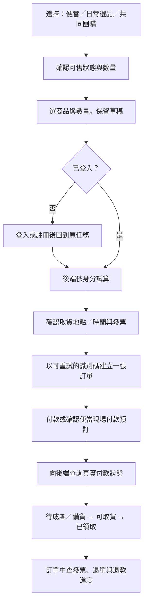

# 全站檢查與商品購買解鎖

日期：2026-10-23
專案：十里方圓農產品 App
檢查基準：`5c061a7fc6b5322a6bbe88e6659e3d36638c051c`；修正分支：`codex/full-project-audit`。

## 先看這裡

**非便當商品的阻擋已在本機修正；使用者已授權部署，目前準備發布。正式站完成驗收後才標示已恢復。**

正式網站公開目錄的 **28 項在架且有庫存商品**，已複製公開商品資料到記憶體資料庫，逐項通過「試算 200 → 建單 201 → 建立付款嘗試 201 → 付款頁轉址 303」。沒有建立正式訂單、占用正式庫存、扣款、開票或更動商品上下架。

這次採用「便當＋一般商品＋團購自取」範圍，移除一般商品必須符合兩款 10 元測試品白名單的限制；商品原有價格、庫存、上架狀態及取貨規則仍由後端檢查。配送與入社費等其他交易沒有因商品開放而一起啟用。

全站檢查另找出以下五組應優先處理的問題；它們尚未因商品解鎖而修復。

| 順序 | 問題 | 影響與證據 |
|---|---|---|
| 1 | 交易重送沒有去重；付款橫幅可與訂單狀態矛盾 | 一般商品與團購相同請求各送兩次均建立兩張單；付款頁以 URL 的 `paid` 決定成功文字。[A2](architecture-review.md)、[UX-02](ui-ux-review.md) |
| 2 | 多選投票截止結算會中斷後續背景工作 | 全新資料庫 session 實測 `MissingGreenlet`，後續便當結算、退款、發票、通知步驟可能延後。[BF-02](business-flow-review.md) |
| 3 | 團購的名額與交易版本不一致 | 售罄團購退款後仍不可再買；改商品後舊訂單仍能付款並占新團名額。[BF-01／06](business-flow-review.md) |
| 4 | 同一會計期間可重複確認結餘 | 只改標籤即可對同期間建立第二份不可逆分配；已隔離重現，未實際付款。[BF-04](business-flow-review.md) |
| 5 | 管理員把投票轉正式團購前，沒有確認交易條件 | 直接採隱藏 92／95 折、固定截止與取貨日期並發布。[UX-01](ui-ux-review.md) |

## 商品為什麼又被擋

本次聊天原始工作樹是早期 Expo 版 `219405a`；確認近期部署筆記與正式分支後，已在此乾淨工作樹建立新分支，對齊 Vite 正式基準。沒有覆蓋主目錄的本機資料。

目前限制分為兩層：

1. 管理後台的 `orders_open` 只表示是否接受新訂單。正式公開 `/v1/platform` 實測是 `true`。
2. 伺服器 `SALES_SCOPE=meals_only` 另外拒絕非便當，只有兩組精確商品 ID／SKU、10 元、單件、自取的驗收品例外。後台原本看不到此範圍。

公開目錄與 quote 沒有同樣限制，所以使用者會先看見商品、加入清單、完成試算，到建單才遇到 409。隔離測試已重現：一般白米 2 包試算 240 元成功，建單回「目前僅開放便當訂購；其他新交易暫未開放」。歷史發布紀錄確認曾為上述兩品放行，並非開放全部一般商品。本次未直接讀取正式環境變數，因此正式 `SALES_SCOPE` 即時值仍需發布時確認，不能把歷史設定當即時量測。

## 本次實作

| 層級 | 修改 |
|---|---|
| 銷售政策 | 新增 `SALES_SCOPE=pickup`；一般商品與團購可自取，便當維持真實場次與取餐檢核；`meals_only`、`all` 保留各自語意 |
| 建單與付款 | 一般商品／團購建單傳入真實銷售通路及履約方式；建立付款與付款頁一致檢查，新範圍仍驗發票平台快照與履約資料 |
| 正式啟動設定 | 自取模式保留正式雷門、汎宇、隱私金鑰與背景補查驗證，不要求尚未啟用的物流／證件儲存服務；既有測試商品成對設定可保留，但不再限制全目錄 |
| 前後台能力同步 | 平台 API 回傳一般商品、團購、配送能力與銷售範圍；結帳提早指出阻擋，後台顯示實際範圍；保留舊 API 相容與兩款驗收品例外 |
| 回歸保護 | 一般商品／團購建單至付款頁、正式設定、暫停接單／下架／缺貨、示範便當阻擋，以及不同銷售範圍的 UI 行為 |

沒有新增資料庫 migration，也沒有更改金流商或發票商憑證。本次不是修復全站所有發現，報告中的其他議題仍待處理。

## 建議的完整使用流程

這是改善後的目標流程；一般商品／團購去重、註冊返回、付款橫幅等尚未全部實作。便當現場付款與商品線上付款仍是不同選項，不應讓前端自行混用。

## UI 優先改善

1. **讓返回真的回到原處。** 商品／團購詳情返回、重新整理及分享保留正確分頁；目前正式站已重現返回選品卻跳到便當。
2. **讓畫面價格與本次試算一致。** 非社員的清單不再固定顯示社員價；舊購物車重新核對價格、庫存與上下架。
3. **指出付款按鈕不能按的原因。** 統編、公司名、手機載具分別顯示欄位錯誤；失效登入提供回到本頁的重新登入入口。
4. **清楚處理關閉與失敗狀態。** 關閉團購顯示結果而非參加；會員 API 故障顯示重試，不誤判未入社；非社員提案頁避免無限載入。
5. **降低找商品與操作負擔。** 28 件選品提供搜尋／分類；加減按鈕有名稱、可鍵盤操作；取貨截止顯示完整台灣日期時間。

不建議先整站換風格。現有米色、深綠、黃色小標可保留；先修任務連續性、價格與操作回饋。

## 程式架構與冗餘

1. 一般商品／團購／便當的付款續辦有重複實作，抽成共用訂單後續處理，統一空付款 URL 與失敗恢復。
2. 取消與退款各自釋放庫存，集中 reservation 狀態轉移與鎖定順序，保留 PostgreSQL 併發測試。
3. 會員資格、session、前台能力等已有多處推導；使用單一可觀察來源，避免 token 已失效而畫面仍顯示登入。
4. 訂單清單目前每 5 秒載入全部歷史；改為分頁，只對正在確認付款的訂單短暫輪詢。
5. CI 應納入關鍵瀏覽器流程，API 契約逐步從只有路徑擴充到資料結構；舊部署文件與待辦需標示歷史／現況。

現有後端權威計價、付款快照、Outbox、資料庫鎖及 migration／併發檢查值得保留；沒有證據要求整套架構重寫。

## 驗證結果與限制

- 原始症狀：新回歸測試在舊 `meals_only` 設定下，quote 200、order 409；已保存重現結果於本次對話。
- 28 項公開商品隔離重播：全部通過，結果在 `outputs/catalog-pickup-results.json`；腳本 [catalog-pickup-repro.py](catalog-pickup-repro.py)。付款頁只產生指向假金流主機的轉址，未跟隨轉址。
- 後端完整套件：1,703 passed、4 skipped；另 10 項 TLS 測試受沙箱綁定本機埠限制，允許本機伺服器後單獨重跑 10 passed，合計 **1,713 項通過、4 項 PostgreSQL 測試略過**。未在本機執行 PostgreSQL／migration 往返或 GitHub CI。
- 前端 **73 項通過**；TypeScript 與 Vite production build 通過。Node 使用 22.23.4；後端本機 Python 3.12.14，精確部署版 Python 3.12.15 需 CI 驗證。
- 隔離 Chromium **17 項通過**：7 項銷售範圍、8 項自取／字級／缺取貨點、2 項既有驗收品；含 390px 手機視窗。API 都由假資料攔截，不能當成正式金流或手機真機通過。
- 業務報告額外六項缺陷有可執行隔離重現；[business-flow-repro.py](business-flow-repro.py) 成功代表症狀重現，不代表行為正確。
- 正式站僅唯讀檢查公開頁面及既有登入畫面；手機真機、真實付款、正式資料庫、跨分頁登入競態與外部供應商均未在此驗收。

## 發布方式

發布需同時包含 **已測程式**與 API 服務的 **`SALES_SCOPE=pickup`**。只部署程式而保留 `meals_only`，一般商品仍會被後端拒絕；只將舊版設定改成 `pickup`，舊版不識別此值，會啟動失敗。這兩者必須作為同一次發布處理。

1. 以最新正式分支整合本次修改並跑 CI，確認沒有覆蓋其他聊天的更新。
2. 準備 API 新版程式與 `SALES_SCOPE=pickup` 一起生效；保留所有既有金流、發票、隱私及列印設定，不變更商品資料。
3. 部署相同修正版本的前端；既有 `VITE_LOGISTICS_ENABLED` 即使為 true，後端回傳的 `shipping_enabled=false` 仍會阻止配送入口。
4. 核對 `/ready`、`/v1/platform`：`orders_open=true`、`sales_scope=pickup`、一般商品及團購為 true、配送為 false；後台應顯示同一範圍。
5. 真實付款驗收另由使用者選定商品完成；沒有真實成功付款前，不宣稱已完成線上金流驗收。若回退舊程式，須同時回復舊 scope；僅回退舊 bundle 會不識別 pickup。

## 詳細清單

- [UI／UX：15 項缺陷與 5 項設計／營運建議](ui-ux-review.md)
- [程式架構、重複邏輯與測試缺口](architecture-review.md)
- [業務流程：六項已重現問題](business-flow-review.md)

相同問題在不同審查視角有交叉引用，不應將三份文件的項目數直接相加當成獨立缺陷數。
